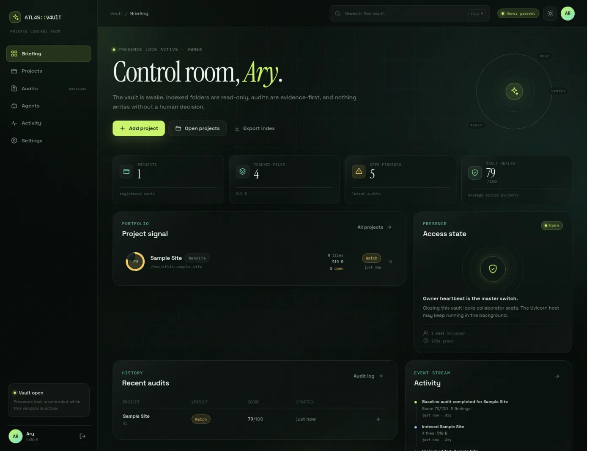

# ATL4S::V4UlT

A private, local-first project vault and control room for **two people**: one owner and one invited collaborator. Index local website/project folders, search what is actually there, and run evidence-first baseline audits without giving an agent write access.

Built with FastAPI, Jinja2, SQLite/FTS5, and a custom glass UI. No Node build step. Runs natively on Linux and Windows, with the same browser interface.



<p align="center"><sub>Briefing · owner presence lock · project signal · event stream</sub></p>

**Screens:** [project](docs/project-dark.webp) · [audit ledger](docs/audit-dark.webp) · [sign in](docs/login-dark.webp). Dark, light, and auto themes share the same layout.

Continuing development? Read **[HANDOFF.md](HANDOFF.md)** for architecture, security invariants, current gaps, and the next slice.

---

## What works now

This repository is the **first vertical slice**: a working local vault, not the final multi-agent product.

- **First-run owner setup** with an owner account and a single-use initialization form.
- **Owner presence lock**: collaborator pages are gated by the owner's browser heartbeat. The Uvicorn host can stay online while the vault is closed.
- **Invite-only second seat**: maximum two users. No public registration.
- **Reviewer access windows**: reviewers can only sign in while a live session is open, and only reach projects with an active window.
- **Full-access collaborator role** with an explicit owner step-up confirmation (owner password re-entry).
- **Read-only project registration**: add a local folder, then walk and index it. Source files are never edited, moved, deleted, committed, pushed, or deployed.
- **SQLite FTS5 search** across paths, titles, summaries, and extracted text.
- **HTML/Markdown metadata extraction** including page titles, meta descriptions, word counts, headings, local links, and external links.
- **Local link validation**, with correct handling for root-relative links such as `/index.html`.
- **Free deterministic baseline audit** with no API key required. Checks structure, documentation, content metadata, empty pages, duplicate content, large files, stale pages, and broken local links.
- **Findings ledger** with severity, evidence paths, recommendations, open/resolved/dismissed states, score, verdict, and CSV exports.
- **Agent and provider registry**: six standard read-only subagents, custom agent registration, provider records, and locally encrypted provider API keys.
- **Authenticator (TOTP) protection**: encrypted enrollment, local code verification at sign-in, and TOTP-aware owner step-up for role changes.
- **Last-used/default model route**: `opencode/deepseek-v4.1-flash-free#high`.
- **Glass UI** with dark/light/auto themes, animated backgrounds, reduced-motion support, responsive rail, and mobile layout.
- **Local event stream** as the canonical in-app activity log.

## What is deliberately not enabled yet

- Model-assisted subagent execution and routing UI. Standard agents are registered, but they do not run model calls in this slice.
- Web Push and native OS notifications. The in-app event stream is the source of truth for now.
- Continuous mode without owner presence.
- Cloudflare Access automation. Deployment guidance is below.
- True OS-window transparency. The glass aesthetic is browser-native.

---

## Quick start

### Linux / macOS

```bash
cd /path/to/databasev1
./run.sh
```

If `run.sh` is not executable:

```bash
chmod +x run.sh
./run.sh
```

### Windows (PowerShell)

```powershell
cd C:\path\to\databasev1
.\run.ps1
```

If script execution is blocked for the current shell:

```powershell
Set-ExecutionPolicy -Scope Process -ExecutionPolicy Bypass
.\run.ps1
```

The scripts create `.venv` and install dependencies if needed. Alternatively:

```bash
python3 -m venv .venv
.venv/bin/pip install -e ".[dev]"
.venv/bin/uvicorn atl4s.main:app --host 127.0.0.1 --port 8000
```

On Windows, use `.venv\Scripts\python.exe` instead of `.venv/bin/python`.

Open <http://127.0.0.1:8000>. The first visit redirects to `/setup`.

### First run

1. Create the owner account.
2. Add a project folder. Do not point it at `/`, your whole home directory, or the vault data directory.
3. Let the first index finish.
4. Run the free baseline audit.
5. Open **Account security** to add an authenticator app. Confirm a current 6-digit code before TOTP becomes mandatory at sign-in.
6. Open **Settings** to invite the second seat.
7. For a reviewer, open a **live review window** on a project first. Reviewer invites require one.
8. Send the one-time invite link over a private channel. The link is shown once in the owner settings view.

The source folder is only read. The vault database, index, findings, users, sessions, and encrypted provider credentials live under the data directory.

---

## Configuration

Bootstrap settings can be loaded from a local `.env` at the project root. Copy `.env.example` to `.env`.

| Variable | Default | Purpose |
| --- | --- | --- |
| `ATL4S_DATA_DIR` | `~/.local/share/atl4s-vault` (Linux), `%LOCALAPPDATA%\ATL4S-Vault` (Windows) | SQLite database, vault keys, uploads, backups |
| `ATL4S_SECURE_COOKIES` | `0` | Set to `1` when served over HTTPS |
| `ATL4S_HOST` | `127.0.0.1` | Uvicorn bind host (read by run scripts) |
| `ATL4S_PORT` | `8000` | Uvicorn bind port (read by run scripts) |

Provider API keys are **not** read from `.env`. Add provider credentials in the app; they are encrypted with Fernet using `vault.key` in the data directory and are never returned to the browser.

### Default data files

| File | Purpose |
| --- | --- |
| `atl4s-vault.db` | Users, sessions, projects, files, index, audits, findings, invites, events |
| `vault.key` | Fernet key for provider credentials |

Back up the database together with `vault.key`. Without `vault.key`, encrypted provider credentials cannot be recovered. Project content is indexed as extracted text in SQLite; the database itself is not encrypted-at-rest, so protect the data directory with OS permissions and disk encryption.

---

## Security model

- Passwords are hashed with `scrypt` and per-password salts.
- TOTP is optional per seat and uses standard RFC 6238 6-digit / 30-second codes. Secrets are encrypted with the local vault key, and pending enrollments expire after 15 minutes.
- Session tokens are random and stored only as hashes.
- Pages use an authenticated session CSRF token; setup, login, and invite forms use double-submit tokens.
- Collaborator access requires an owner presence window. Closing the vault closes collaborator access without stopping the host process. Open collaborator pages also poll the server and redirect to the locked screen when presence ends.
- Reviewer access is both task-gated and presence-gated:
  - reviewer login requires owner presence and at least one live task window;
  - project access requires a live window for that project.
- Full-access collaborators can index, audit, manage findings, and register personal agents/providers. They cannot change roles, create invites, remove people, or register filesystem roots. Personal agents/providers are hidden from other seats.
- Remote provider URLs must use HTTPS. Plain HTTP is accepted only for loopback hosts.
- Owner role elevation for a collaborator requires re-entering the owner password, plus the current TOTP code when TOTP is enabled.
- File scanning skips common dependency/cache directories and secret-like files, but these filters are **best-effort**. Do not register a folder whose contents you would not want extracted into the local SQLite index.
- No agent writes, commits, pushes, deploys, or destructive actions are enabled.
- Content Security Policy, `X-Frame-Options: DENY`, `nosniff`, and no-store HTML responses are set by middleware.

### Important boundary

Owner presence is a browser heartbeat, not an OS-level proof of identity. It is designed to make the vault behave like a shared control room with the owner at the desk. For stronger guarantees, run the host on a trusted machine with full-disk encryption and keep the Uvicorn port bound to localhost.

---

## Public deployment with Cloudflare Tunnel + Access

Keep Uvicorn on localhost and let Cloudflare reach it. Do not open the Python port directly to the internet.

1. Install `cloudflared` on the host.
2. Start the app:
   ```bash
   ATL4S_SECURE_COOKIES=1 ./run.sh
   ```
3. Authenticate `cloudflared` and create/route a named tunnel:
   ```bash
   cloudflared tunnel login
   cloudflared tunnel create atl4s
   cloudflared tunnel route dns atl4s vault.example.com
   ```
4. Point the tunnel at the local app. Minimal config:
   ```yaml
   tunnel: <tunnel-id>
   credentials-file: /home/you/.cloudflared/<tunnel-id>.json
   ingress:
     - hostname: vault.example.com
       service: http://127.0.0.1:8000
     - service: http_status:404
   ```
5. In Cloudflare Zero Trust, create an **Access application** for `vault.example.com`, then add an allow policy for exactly the owner and collaborator emails. Both emails must already be authorized at the edge; the app enforces its own two-seat rule as well.
6. Run the tunnel:
   ```bash
   cloudflared tunnel run atl4s
   ```

For a temporary test URL, `cloudflared tunnel --url http://127.0.0.1:8000` also works. Set `ATL4S_SECURE_COOKIES=1` for any HTTPS deployment.

The app is designed for one host and two people. It is not a multi-tenant service.

---

## Project layout

```
atl4s/
  main.py        FastAPI routes, middleware, forms, view models
  db.py          SQLite schema, seed data, event log
  security.py    password/session/CSRF/presence/invite/access-window logic
  indexing.py    read-only walker, parsers, link resolution, FTS search
  audits.py      deterministic baseline checks, scoring, findings
  totp.py        RFC 6238 codes, encrypted enrollment, TOTP helpers
  vault.py       Fernet encryption and provider credential access
  config.py      paths, environment loading, defaults
  templates/     Jinja shells and pages
  static/        custom CSS, JS, local fonts
tests/
  test_core.py   setup/login CSRF, TOTP, indexing, audit, search, reviewer gating
```

### Baseline audits

The free baseline is deterministic and does not call a model. It currently checks:

- README presence and depth;
- root crowding, large files, duplicate content, empty/deep folders;
- HTML titles and descriptions;
- empty and stale pages;
- broken local links and external-link counts.

Scores are weighted by severity with a per-category penalty cap, producing `healthy`, `watch`, `needs-work`, or `critical` verdicts. Findings are persisted with evidence and recommendations so a later model-assisted judge can add to the ledger rather than replace it.

---

## Tests

```bash
.venv/bin/pytest -q
```

The integration test covers owner setup, login CSRF, TOTP enrollment and sign-in, project registration, indexing, root-relative link handling, baseline findings, FTS search, settings, TOTP-aware owner step-up, reviewer invite/session access, agent visibility, and the owner-presence lock.

You may see a Starlette deprecation warning about `httpx` in the test client; it does not affect the app.

---

## Next slices

1. Owner-managed allowed-root policy and in-app account hardening such as password rotation.
2. Model-assisted agent runtime using the registered standard panel and per-folder routing rules.
3. Verifier/judge passes layered on top of deterministic findings.
4. Web Push, native OS notifications, and a notification inbox backed by the event log.
5. Continuous-mode design hooks with explicit owner opt-in and hard budget/action caps.
6. Cloudflare Access-aware deployment checks and optional public-status page.

The current slice is intentionally conservative: it proves the vault, permissions, indexing, audit ledger, and visual language before any agent gets a tool.
